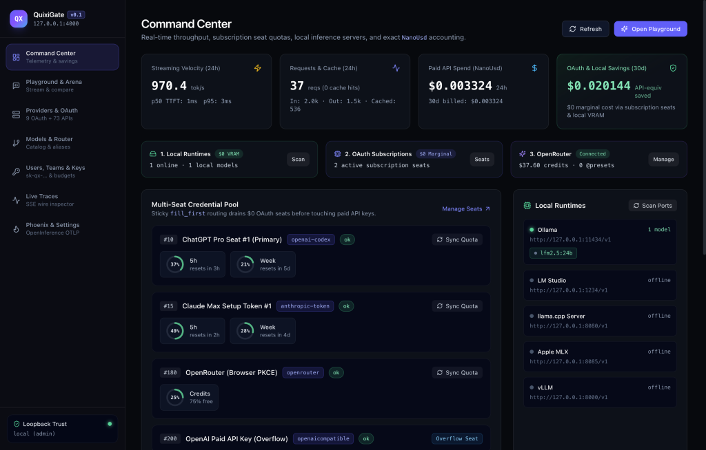
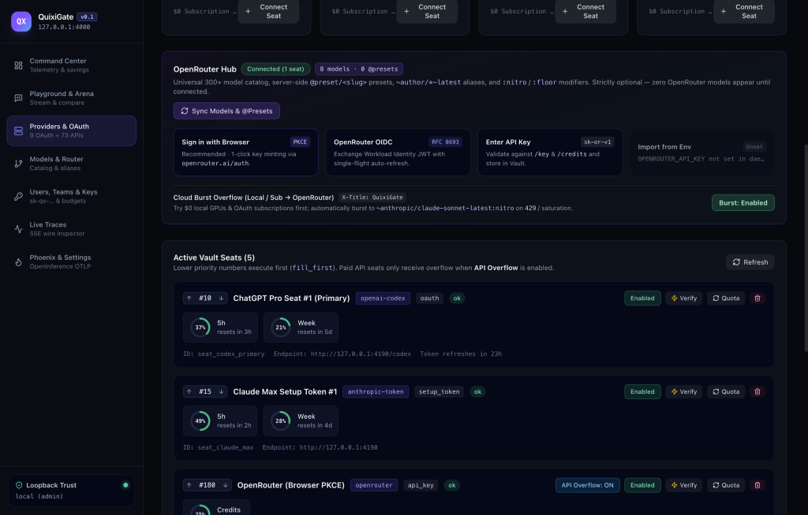
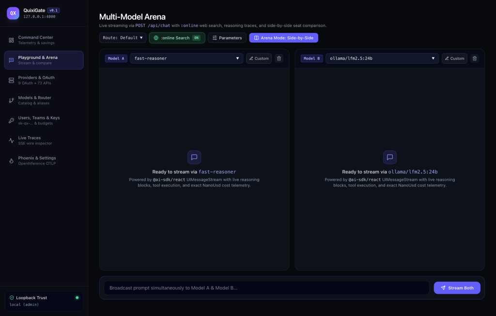
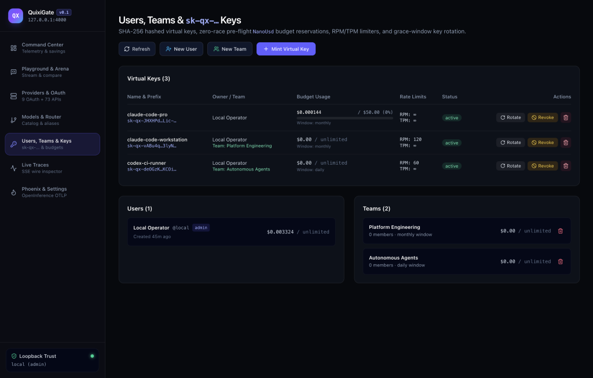
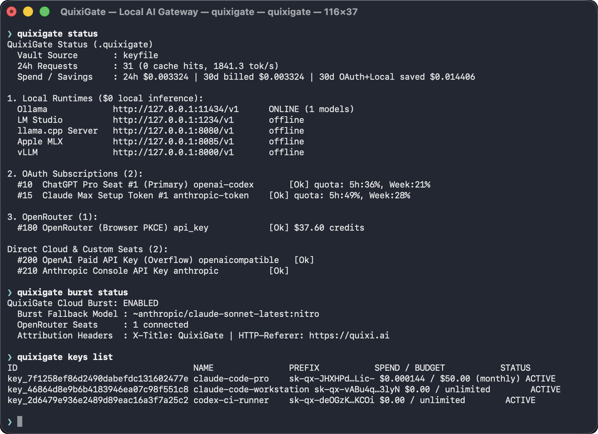
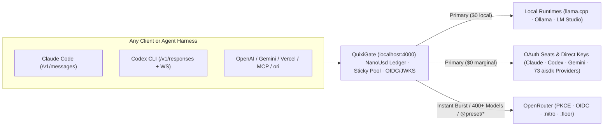

# QuixiGate

**A faster, lighter, MIT-licensed alternative to [LiteLLM Proxy](https://github.com/BerriAI/litellm).**

One Rust binary. No PostgreSQL or Redis. No enterprise license gates on built-in governance.  
Serve OpenAI, Anthropic, Gemini, OpenRouter, Vercel AI SDK, and MCP clients through a single endpoint while routing across local GPUs, OAuth subscription seats, and cloud APIs.

[](https://github.com/QuixiAI/QuixiGate/actions/workflows/ci.yml)
[](https://github.com/QuixiAI/QuixiGate/releases/latest)
[](LICENSE)

**Why people switch:**

1. **Less overhead** — small compiled Rust binary instead of a Python service stack.
2. **Fewer services to run** — embedded SQLite (WAL) + AES-256-GCM vault and budgets; no external Postgres or Redis required.
3. **Governance without a paid tier** — virtual keys, OIDC/JWKS, audit logs, team controls, model restrictions, and hosted `/mcp` all under MIT.
4. **One local → subscription → cloud path** — auto-discover local runtimes, pool OAuth seats with sticky routing, and optionally burst to OpenRouter on 429/saturation.
5. **Clean, auditable code** — `~44K` Rust SLOC across 9 focused crates vs. LiteLLM's `~1.2M` LOC (~27× smaller), with zero vendor SDK bloat or in-process SaaS anti-patterns.

**macOS & Linux:**

```bash
curl -fsSL https://raw.githubusercontent.com/QuixiAI/QuixiGate/main/install.sh | sh
```

**Windows (PowerShell):**

```powershell
irm https://raw.githubusercontent.com/QuixiAI/QuixiGate/main/install.ps1 | iex
```

**Start & run:**

```bash
# Start the gateway
quixigate serve

# Optional: connect OpenRouter and enable fallback
quixigate login openrouter
quixigate burst enable

# Launch a coding CLI without touching its dotfiles
quixigate run claude
```

> Both installers verify SHA-256 checksums, install to `/usr/local/bin/quixigate` on macOS & Linux (`%LOCALAPPDATA%\Programs\QuixiGate\bin\quixigate.exe` — or `C:\Program Files\QuixiGate\bin` when elevated — on Windows), and fall back to `cargo install` if needed. Inspect [`install.sh`](install.sh), [`install.ps1`](install.ps1), or download macOS, Linux, and Windows archives directly from [Releases](https://github.com/QuixiAI/QuixiGate/releases/latest). Local inference requires a running model server (or a configured upstream).

## QuixiGate vs. LiteLLM Proxy

| Dimension | **QuixiGate** | **LiteLLM Proxy** |
| :--- | :--- | :--- |
| **Runtime / Cold Start** | Compiled Rust (`tokio` + `axum`); **`<10 ms`** cold start | Python-based; **`15–45 s`** typical startup depending on environment |
| **Memory & Distribution** | **`~18 MB`** single binary (`macOS arm64` release) · **`<20 MB`** idle RSS | Python + Node/Prisma stack; memory varies with enabled services and load (often 800 MB–1.5 GB+) |
| **Infrastructure for Keys & Budgets** | Embedded **SQLite (WAL)** + AES-256-GCM vault; zero external database or cache | PostgreSQL-backed key/spend management; Redis commonly used for coordination and caching |
| **Licensing** | MIT; no paid tier for OIDC/JWKS, audit logs, virtual keys, team budgets, tags, or `/mcp` | Open-source core plus separately licensed enterprise features (gates vary by release) |
| **Budget Accounting** | Exact **`NanoUsd`** (`i64`, `10⁻⁹` USD) integer ledger with race-free SQLite reservations | Floating-point spend calculations in relevant paths |
| **Local Models** | Zero-config auto-discovery of `llama-server`, Ollama, LM Studio, MLX, and vLLM with live VRAM/slot awareness | Local providers configured via YAML or API |
| **Subscription + Cloud Routing** | Multi-seat OAuth pooling with sticky `fill_first` cache affinity + optional 1-click OpenRouter PKCE burst | Provider/model routing and fallbacks; behavior depends on configuration and license |
| **Coding-CLI Launching** | `quixigate run` injects environment in-memory for `claude`, `codex`, `gemini`, `opencode`, and `ori` (zero dotfile mutation) | Clients pointed at the proxy via environment or config |
| **Observability / MCP** | Built-in OpenInference OTLP (http/protobuf & gRPC) + free Streamable-HTTP `/mcp` | Callbacks and integrations; some admin/MCP features paywalled |
| **LiteLLM API Compatibility** | **997 / 997** LiteLLM routes accounted for: live data/control-plane parity + actionable `400` DIY migration guidance on excluded SaaS/RAG routes | Reference surface |
| **Source Scope** | **`~44K`** production Rust SLOC (+ optional UI) across 9 crates | Larger Python + TypeScript codebase with broader integration surface |

**Comparison notes:** Size and startup figures reflect release builds (`lto = "fat"`, `mimalloc`, stripped symbols). Startup time, RSS, and throughput vary by hardware, OS, and enabled features. Licensing notes reflect an audit of LiteLLM's repository snapshot and may evolve across releases. Independent benchmarks and verification are welcome.

## Screenshots



| Providers, OAuth & OpenRouter | Multi-Model Arena (`:online`) |
| :---: | :---: |
|  |  |

| Users, Teams & Virtual Keys | Headless CLI |
| :---: | :---: |
|  |  |

## 60-Second Quickstart

### 1. Local models only

If Ollama or `llama-server` is already running, QuixiGate discovers it automatically:

```bash
quixigate serve

curl http://127.0.0.1:4000/v1/chat/completions \
  -H "Content-Type: application/json" \
  -d '{"model": "qwen2.5-coder:7b", "messages": [{"role": "user", "content": "Hello!"}]}'
```

### 2. Add OpenRouter overflow or frontier models

```bash
quixigate login openrouter
quixigate burst enable --model ~anthropic/claude-sonnet-latest:nitro

quixigate run claude --model ~anthropic/claude-opus-latest:nitro
quixigate run ori --model @preset/code-reviewer
```

### 3. Management API and optional UI

All operations are API-driven, including full LiteLLM-compatible control-plane parity (`/key/*`, `/user/*`, `/customer/*` & `/end_user/*`, `/team/*`, `/budget/*`, `/tag/*`, `/access_group/*`, `/fallback*`, `/model/*`, `/credentials*`, `/v1/mcp/server*`, `/spend/*`, `/global/*`, `/audit/logs`, `/public/*`, and `/openapi.json`). Loopback and local Docker containers work out of the box. Remote access uses `sk-qx-…` virtual keys or OIDC/JWKS bearer tokens. `QUIXIGATE_MASTER_KEY` / `LITELLM_MASTER_KEY`, Azure `api-key`, and `x-litellm-*` headers are accepted natively.

Toggle the embedded Command Center live:

```bash
curl -X POST http://127.0.0.1:4000/api/admin/ui/enable
curl -X POST http://127.0.0.1:4000/config/ui -H "Content-Type: application/json" -d '{"enabled": false}'
```

## How Traffic Flows



## Supported Protocols

| Client Wire Protocol | Endpoint | Notes |
| :--- | :--- | :--- |
| **OpenAI Chat & Legacy Completions** | `POST /v1/chat/completions`, `POST /v1/completions` | Streaming SSE, tools, `:online` search, JSON schema, Azure `/openai/deployments/{model}/*`, Cursor `/cursor/*` |
| **OpenAI Responses** | `POST /v1/responses` + **WebSocket** | Native Codex CLI WebSocket & SSE streaming + `/input_tokens` & `/compact` |
| **Multimodal, Rerank & Search** | `/v1/embeddings`, `/v1/images/*`, `/v1/audio/*`, `/v1/moderations`, `/v1/rerank`, `/v1/search*` | Image gen/edits, TTS & Whisper STT, local+upstream moderation, Cohere/Jina rerank, 6-engine web search |
| **Anthropic Messages** | `POST /v1/messages`, `/count_tokens` | Native Claude Code thinking & tool blocks (+ unprefixed `/messages`) |
| **Google Gemini** | `POST /v1beta/models/{model}:{action}` | `generateContent`, `streamGenerateContent` & `countTokens` |
| **OpenRouter API Surface** | `/api/v1/{models,presets,credits,key,...}` | Drop-in compatibility for `ori` & OpenRouter SDKs |
| **Vercel AI SDK** | `POST /api/chat` | Data Stream Protocol (`VercelUIStream`) |
| **Hosted MCP & REST Bridge** | `/mcp`, `/v1/mcp/server*`, `/mcp-rest/tools/*` | Streamable-HTTP JSON-RPC 2.0 (`web_search`, `web_fetch`, models, spend, audit) + external MCP registry |

## Governance Features Included Under MIT

Authentication, auditability, cost attribution, and basic security controls ship free:

| Capability | What QuixiGate Includes |
| :--- | :--- |
| **OIDC / JWKS SSO** | Native OIDC Discovery + JWKS (RS*, PS*, ES256/ES384, EdDSA), live `kid` rotation, unlimited JIT users/teams |
| **Audit Logs** | Immutable SQLite log of every key, credential, route, user, team, and settings change + `GET /audit/logs` |
| **Tags & Tag Budgets** | Tags on keys/teams/requests + exact NanoUsd per-tag budgets + `GET /spend/report` |
| **Per-Model Budgets** | Atomic SQLite pre-flight NanoUsd reservations on virtual keys and teams |
| **Hosted `/mcp`** | Streamable-HTTP MCP exposing web search, web fetch, model catalog, spend, and admin inspection |
| **Key Rotation** | Self-service and admin regeneration with configurable grace windows |
| **Wildcard Model ACLs** | Glob matching (`ollama/*`, `anthropic/*`, `@preset/*`) on keys and teams |
| **Secret Scanner & Guardrails** | In-process scanner that redacts or blocks leaked secrets (`sk-`, `sk-ant-`, `ghp_`, `AKIA`, PEM keys, etc.) + banned keywords |
| **Zero-Retention Controls** | Per-key `log_payloads` override and `x-quixigate-no-log: true` request header |
| **Network ACLs & Split-Plane** | Global and per-key CIDR allowlists, disable-admin / disable-inference flags, enforced params, `/robots.txt` |
| **Teams & RBAC** | Unlimited users/teams, team-admin roles, team-scoped routes, self-service spend reads |
| **Encrypted Vault** | Built-in AES-256-GCM SQLite credential vault + filtered OpenAPI |

## Why the Codebase Stays Smaller

QuixiGate comprises ~44K production Rust SLOC across 9 crates. It stays compact by refusing several patterns common in larger Python gateways:

1. **No in-process vendor logger and cloud SDK soup.** Emits vendor-neutral OpenTelemetry / OpenInference OTLP once. An external collector fans out to any sink.
2. **No 4-tier multi-tenant ORM.** Embedded SQLite (WAL) with Team + User + VirtualKey + EndUser + Budgets + Tags + AccessGroups + OIDC claim mapping covers governance without external databases.
3. **No external secret-manager or cloud-moderation sidecars.** Container/systemd environment injection + embedded AES-256-GCM vault + local secret/keyword scanner.
4. **No hand-maintained provider glue or static pricing.** Upstream adapters live in the Rust [`aisdk`](https://crates.io/crates/aisdk) crate; capabilities and pricing are synced live from `models.dev` and OpenRouter.
5. **Strict proxy scope — with actionable migration guidance instead of blind `404`s.** Not an all-in-one SaaS: no bundled RAG, vector stores, OCR/video pipelines, SCIM sync, or fine-tuning orchestrators. If an existing LiteLLM client calls one of those intentionally excluded routes (all **997** LiteLLM routes are tested in CI), QuixiGate returns a fast-fail `400 Bad Request` (`type: "unsupported_litellm_endpoint"`, `x-should-retry: false`) explaining *why* it stays out of the proxy, the native QuixiGate alternative, and step-by-step instructions to implement equivalent functionality cleanly.

## Build Profiles

| Build Profile | Cargo Invocation | Included Surface |
| :--- | :--- | :--- |
| **Full Default** (`ui` + `subscription-oauth`) | `cargo build --release` | All 9 OAuth portals, local runtimes, OpenRouter PKCE/OIDC/Burst, 73 `aisdk` APIs, embedded `/ui` |
| **API & Local Only** | `cargo build --release --no-default-features --features ui` | Local runtimes, OpenRouter, 73 BYOK APIs, embedded `/ui` (no subscription OAuth) |
| **Headless Daemon** | `cargo build --release --no-default-features --features subscription-oauth` | Pure API/CLI binary without the `rust-embed` SPA bundle |

Requires a recent Rust toolchain (edition 2024).

## License & Status

Licensed under the [MIT License](LICENSE).

