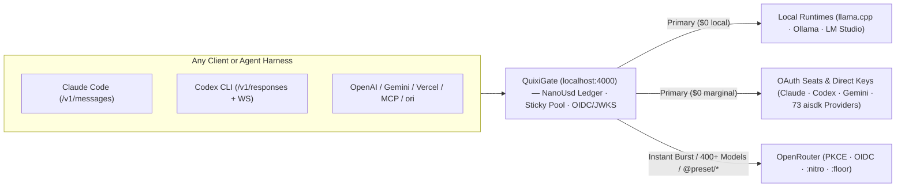
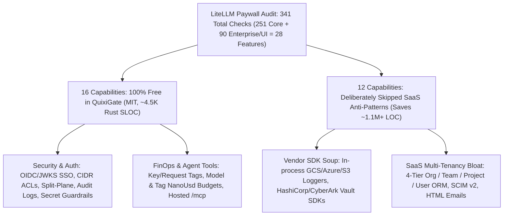

# QuixiGate

**QuixiGate is a faster, better alternative to [LiteLLM Proxy](https://github.com/BerriAI/litellm) — written in Rust and shipped as a single `~18 MB` binary.**

Point Claude Code, Codex CLI, Gemini CLI, OpenCode, Open WebUI, `ori`, or any OpenAI/Anthropic/Gemini SDK at `localhost:4000` (or drop it in front of your team's LiteLLM `/key/*`, `/team/*`, and `/spend/*` workflows) to unify local GPUs, coding subscriptions, and 400+ cloud models with **zero Python virtualenvs, zero Postgres/Redis containers, and zero enterprise paywalls**.

## Why QuixiGate Is Faster & Better Than LiteLLM

| Dimension | **QuixiGate** | **LiteLLM Proxy** |
| :--- | :--- | :--- |
| **Cold Start & Proxy Overhead** | **`<10 ms`** start · sub-millisecond Rust (`tokio` + `axum`) streaming pass-through | **`15–45 s`** Python import/startup · GIL & async event-loop overhead under load |
| **Memory & Binary Footprint** | **1 static `~18 MB` binary** · **`<20 MB` idle RAM** | Python + Node/Prisma runtime · **`~800 MB–1.5 GB+` RAM** |
| **Infrastructure Dependencies** | **Zero** — embedded **SQLite (`WAL`)** + **AES-256-GCM** credential vault in one file | Requires external **PostgreSQL + Prisma migrations + Redis** for keys, budgets & multi-worker routing |
| **Enterprise Paywalls** | **0** — 100% **MIT** (OIDC/JWKS SSO, audit logs, tags, key rotation, CIDR ACLs & `/mcp` all free) | **341 license gates** (**251** `not_premium_user` checks in core + **90** across `enterprise/` & `ui/`) |
| **Cost & Budget Precision** | Exact **`NanoUsd` (`i64`, `10⁻⁹` USD)** integer ledger + race-free atomic SQLite reservations | IEEE-754 floating-point math (rounding drift) + eventual-consistency budget checks |
| **Local Model Intelligence** | **Zero-config auto-discovery** of `llama-server`, Ollama, LM Studio, MLX & vLLM with live VRAM/slot checks | Manual YAML static endpoints per local model |
| **Subscriptions + Cloud Burst** | **Multi-seat OAuth pool** (`fill_first` sticky cache affinity) + **1-click OpenRouter PKCE** `:nitro` burst on `429` | Paid API keys first; no unified local → OAuth seat → 1-click OpenRouter PKCE burst waterfall |
| **Client & Harness Launching** | **`quixigate run`** (`claude`, `codex`, `gemini`, `opencode`, `ori`) injects env in-memory (**zero dotfile mutation**) | Manual shell env exports or config-file edits per tool |
| **Observability & Agent Tools** | Built-in **OpenInference OTLP** (`http/protobuf` & `gRPC`) + free Streamable-HTTP **`/mcp`** server | 150+ in-process vendor SDK callbacks in the hot path + paywalled `@require_enterprise_license` admin MCP |
| **Codebase & Attack Surface** | **`~35K` Rust SLOC** (+ `~8K` optional UI — **~30× smaller**, memory-safe, `0` npm vulnerabilities) | **`~1.2M` LOC** Python + TypeScript monolith |

## Screenshots


| **Providers, OAuth & OpenRouter Cloud Burst** | **Multi-Model Side-by-Side Arena (`:online` Search)** |
| :---: | :---: |
|  |  |
| **Users, Teams & `sk-qx-…` Virtual Keys** | **Headless CLI (`status`, `burst`, `keys`)** |
|  |  |

```bash
curl -fsSL https://raw.githubusercontent.com/QuixiAI/QuixiGate/main/install.sh | sh
quixigate serve                     # Cold-starts in <10ms on :4000 (<20 MB RAM)
quixigate login openrouter          # Optional: 1-click browser PKCE (or connect local/OAuth)
quixigate burst enable              # Optional: auto-burst to OpenRouter when local/sub hits 429
quixigate run claude                # Launch any coding harness with zero dotfile mutation
```

---

## How Traffic Flows



## 60-Second Quickstart

### 1. Use Purely Local Models (Zero Cloud Account Required)
If `ollama` or `llama-server` is running locally, QuixiGate discovers it automatically:
```bash
quixigate serve
curl http://127.0.0.1:4000/v1/chat/completions \
  -H "Content-Type: application/json" \
  -d '{"model": "qwen2.5-coder:7b", "messages": [{"role": "user", "content": "Hello!"}]}'
```

### 2. Add Automatic Cloud Overflow or 400+ Frontier Models
Connect OpenRouter in one browser click (PKCE), via OIDC Workload Identity, or from `OPENROUTER_API_KEY`:
```bash
quixigate login openrouter
quixigate burst enable --model ~anthropic/claude-sonnet-latest:nitro

# Use OpenRouter dynamic aliases, @presets, and routing modifiers from any client:
quixigate run claude --model ~anthropic/claude-opus-latest:nitro
quixigate run ori --model @preset/code-reviewer
```

### 3. Headless-First Management API (Optional Live `/ui`)
Every operation is API-driven (including LiteLLM-compatible `/key/*`, `/user/*`, `/team/*`, `/spend/*`, `/audit/logs`, `/config/*` routes and `/openapi.json`). Loopback (`127.0.0.1` / `::1`) and local Docker containers (`host.docker.internal`) work out of the box; remote peers authenticate via `sk-qx-...` Virtual Keys or **OIDC / JWKS Bearer JWTs** (`QUIXIGATE_MASTER_KEY` / `LITELLM_MASTER_KEY` and `x-litellm-*` headers work as drop-in aliases).

Switch the embedded `/ui` Command Center on or off live — no config file edit or restart needed:
```bash
curl -X POST http://127.0.0.1:4000/api/admin/ui/enable
curl -X POST http://127.0.0.1:4000/config/ui -H "Content-Type: application/json" -d '{"enabled": false}'
```

## Polyglot Ingress, Unified Core

| Client Wire Protocol | QuixiGate Endpoint | Notes |
| :--- | :--- | :--- |
| **OpenAI Chat Completions** | `POST /v1/chat/completions` | Streaming SSE, tools, `:online` search, JSON schema, `mock_response` |
| **OpenAI Responses** | `POST /v1/responses` + **WebSocket** | Native Codex CLI WebSocket & SSE streaming |
| **Anthropic Messages** | `POST /v1/messages`, `/count_tokens` | Native Claude Code thinking & tool blocks |
| **Google Gemini** | `POST /v1beta/models/{model}:{action}` | `generateContent` & `streamGenerateContent` |
| **OpenRouter API Surface** | `/api/v1/{models,presets,credits,key,...}` | Drop-in compatibility for `ori` & OpenRouter SDKs |
| **Vercel AI SDK** | `POST /api/chat` | Data Stream Protocol (`VercelUIStream`) |
| **Hosted MCP Server** | `POST /mcp`, `GET /mcp`, `DELETE /mcp` | Streamable-HTTP JSON-RPC 2.0 (`web_search`, `web_fetch`, models, spend, audit) |

---

## The Zero-Paywall Audit: ~35K Rust SLOC vs. LiteLLM's ~1.2M LOC & 341 License Gates

Auditing LiteLLM's codebase reveals **251 `not_premium_user` checks across 43 core Python files** plus **90 additional license checks** across `enterprise/` and `ui/` (**341 total paywall gates** enforcing **28 distinct feature locks**).

When you strip away duplicated CRUD checks, those 341 gates tell a clear architectural story: half of them **tax basic operational security** (audit logs, key rotation, tags, IP allowlists, even `/robots.txt`), while the other half exist only to monetize **in-process SaaS bloat** that never belonged inside an LLM proxy.



### 1. Paywalled in LiteLLM — **100% Free in QuixiGate**

QuixiGate treats authentication, auditability, cost attribution, and security hygiene as baseline open-source infrastructure — never an enterprise upsell:

| Capability | What LiteLLM Does Without an Enterprise Key | What QuixiGate Ships Free (MIT) |
| :--- | :--- | :--- |
| **Inbound OIDC / JWKS Bearer SSO** | Rejects OAuth2/JWKS bearer tokens on `/v1/*` (`oauth2_check.py`) & `/mcp` (`user_api_key_auth_mcp.py`); caps UI SSO at **5 users** (`ui_sso.py`) | Native **OIDC Discovery + JWKS** (`RS*`, `PS*`, `ES256`/`ES384`, `EdDSA`), Cloudflare Access fallback, live `kid` rotation, and **unlimited** JIT users/teams/roles |
| **Immutable Management Audit Logs** | `audit_logs.py` **silently returns early without writing rows** when `premium_user is not True` | Built-in SQLite `audit_logs` table recording every key, credential, route, user, team, and settings mutation + `GET /audit/logs` |
| **Key & Request `tags` + Tag Budgets** | Throws *"Only premium users can add tags to keys"*; gates `tag_budget_config` & `GET /spend/report` | Full `tags` on keys, teams, and requests (`x-quixigate-tags` / `metadata.tags`), exact `NanoUsd` per-tag budgets, and `GET /spend/report` (`tag`, `model`, `team`, `key`, `day`) |
| **Per-Model Budgets (`model_max_budget`)** | Gates per-model spend ceilings on keys and teams | Enforced atomically in SQLite pre-flight budget reservations (`NanoUsd`) on both Virtual Keys and Teams |
| **Hosted Gateway MCP Server (`/mcp`)** | Locked behind `@require_enterprise_license("Hosted admin MCP")` (`admin_mcp.py`) | Native Streamable-HTTP `/mcp` server exposing `quixigate_web_search` (6-engine waterfall), `quixigate_web_fetch`, model catalog, spend reports, and admin inspection |
| **Zero-Downtime Key Rotation** | Blocks non-master `POST /key/{key}/regenerate` | Self-service & admin key regeneration/rotation with configurable grace windows (`virtual_key_rotations`) |
| **Wildcard Model ACLs** | Gates wildcard patterns (`anthropic/*`, `ollama/*`) in `allowed_models` | Native glob matching (`ollama/*`, `anthropic/*`, `@preset/*`) on every Virtual Key and Team |
| **Local Secret Scanner & Guardrails** | Gates `SecretDetection`, `BannedKeyword`, and `BlockedUser` callbacks | In-process microsecond scanner that redacts or `400`-blocks leaked secrets (`sk-`, `sk-ant-`, `ghp_`, `AKIA`, PEM private keys) + banned keywords + `/user/block` |
| **Zero-Retention Privacy Controls** | Gates per-key & per-header logging opt-outs (`callback_controls.py`) | Per-key `log_payloads` override and per-request `x-quixigate-no-log: true` privacy header |
| **Network ACLs, Split-Plane & `/robots.txt`** | Gates `allowed_ips`, `DISABLE_ADMIN_ENDPOINTS`, `max_request_size_mb`, `enforced_params`, and throws *"Blocking web crawlers is an enterprise feature"* on `/robots.txt` | Global & per-key CIDR `allowed_cidrs`, split-plane flags (`disable_admin_endpoints` / `disable_inference_endpoints`), `enforced_params`, dynamic body limits, and `GET /robots.txt` (`Disallow: /`) |
| **Teams, Team-Admin RBAC & Self-Service Spend** | Enforces `max_users` / `max_teams`; gates `member.role == "admin"`, team-scoped models, and self-service key spend reads | Unlimited users & teams, `team_members` admin RBAC, team-scoped routes (`team_id`), and self-service `/key/info` & `/spend/logs` |
| **Encrypted Vault & Filtered OpenAPI** | Gates external secret managers and `DOCS_FILTERED` / `DOCS_TITLE` OpenAPI customization | Built-in **AES-256-GCM** SQLite credential vault, custom `docs_title` / `docs_description`, and `docs_filtered` inference-only `/openapi.json` |

### 2. Why LiteLLM Hit ~1.2M LOC vs. QuixiGate's ~35K Rust SLOC

QuixiGate wasn't shrunk by cutting corners — it stays **~30× smaller** (`~35K` production Rust SLOC across 9 crates, vs. LiteLLM's `~1.2M` LOC) by **refusing five SaaS anti-patterns** that bloat Python AI gateways:

1. **No In-Process Vendor Logger & Cloud SDK Soup:** LiteLLM bundles 150+ proprietary SaaS callbacks (`GCSBucket`, `GCSPubSub`, `AzureBlobStorage`, `S3`, Datadog, Langfuse, Slack HTML mailers) directly inside the proxy process — then paywalls half of them. QuixiGate emits vendor-neutral **OpenTelemetry / OpenInference OTLP** (`http/protobuf` & `gRPC`) once; an external OTel Collector can fan out to any cloud bucket or warehouse with **zero vendor SDKs in the hot path**.
2. **No 4-Tier Multi-Tenant ORM Sprawl:** LiteLLM drags in Postgres + Prisma + Redis + SCIM v2 directory sync + custom HTML email templates to model `Organization → Team → Project → User`. QuixiGate's embedded **SQLite (`WAL`)** with `Team + User + VirtualKey + tags` + OIDC claim mapping handles 99% of attribution in `<20 MB` RAM with **zero external databases**.
3. **No External Secret-Manager or Moderation Sidecar Bloat:** Instead of shipping HashiCorp Vault, CyberArk, and Google Secret Manager SDKs or adding 200ms cloud-moderation HTTP round-trips to every token stream, QuixiGate pairs standard container/systemd environment injection with an embedded **AES-256-GCM** vault and microsecond local secret/keyword guardrails.
4. **No Hand-Rolled 100-Provider & Static Pricing Treadmill:** LiteLLM maintains hundreds of thousands of lines of brittle per-provider Python glue and static pricing JSON commits. QuixiGate delegates upstream wire adapters to Rust [`aisdk`](https://crates.io/crates/aisdk) and syncs capabilities and token pricing live from `models.dev` and OpenRouter's `/api/v1/models` catalog.
5. **Strict Proxy Scope (Explicit Non-Goals):** QuixiGate is a fast systems-level proxy — **not** an all-in-one SaaS monolith. It will never bundle RAG/PDF chunkers, vector stores, OCR/video pipelines, fine-tuning batch orchestrators, or custom-branded Slackbots.

---

## Compile-Time Feature Flags

| Build Profile | Cargo Invocation | Included Surface |
| :--- | :--- | :--- |
| **Full Default** (`ui` + `subscription-oauth`) | `cargo build --release` | All 9 OAuth subscription portals, Local runtimes, OpenRouter PKCE/OIDC/Burst, 73 `aisdk` APIs, embedded `/ui` |
| **API & Local Only** (`ui`, no subscription OAuth) | `cargo build --release --no-default-features --features ui` | Local runtimes, OpenRouter PKCE/OIDC/Burst, 73 `aisdk` BYOK APIs, embedded `/ui` |
| **Headless Daemon** (zero UI assets) | `cargo build --release --no-default-features --features subscription-oauth` | Pure API/CLI binary without `rust-embed` SPA bundle |

---

## License & Status

Licensed under the [MIT License](LICENSE).
> *Experimental open-source infrastructure — provided as-is without SLA commitments. Contributions welcome at [github.com/QuixiAI/QuixiGate](https://github.com/QuixiAI/QuixiGate).*
